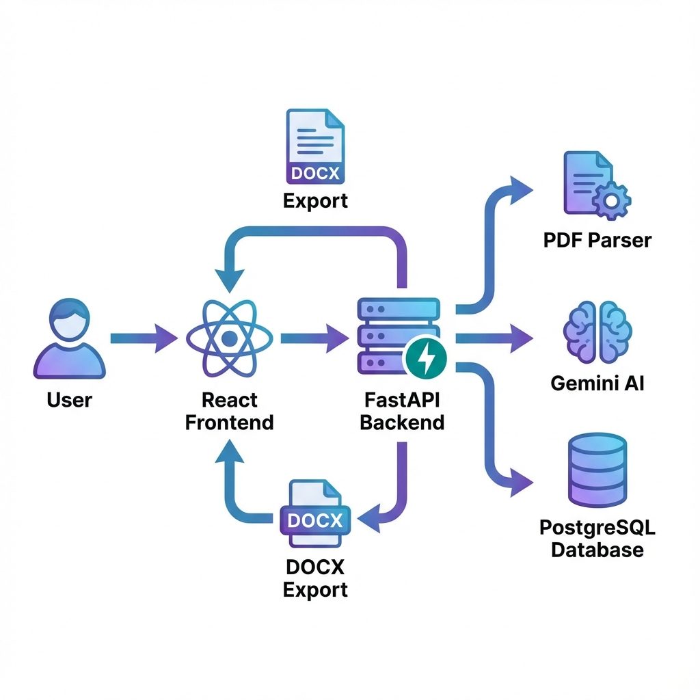
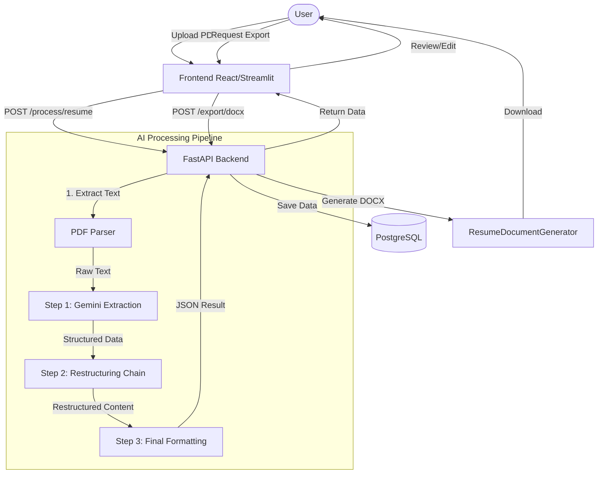

# 📄 AI Resume Processor

A web-based resume formatting system powered by Google's Gemini 2.5 Flash model. This tool automatically parses, restructures, and formats resumes into professional templates using LLM workflows.

## ✨ Features

- **📄 Document Parsing**: Robust extraction of text from PDF resumes.
- **🤖 AI-Powered Formatting**: Utilizes LangChain and Google Gemini to intelligently restructure resume content (Experience, Education, Skills, etc.).
- **📝 Dual Interfaces**:
  - **Modern React Frontend**: A responsive web application built with TypeScript, Tailwind CSS, and Radix UI.
  - **Streamlit Dashboard**: A quick-start interactive dashboard for rapid testing and usage.
- **✏️ Interactive Editing**: Allows you to review and edit parsed data before generating the final document.
- **💾 Export to DOCX**: Generates perfectly formatted Word documents based on processed data.
- **🔐 User System**: Authentication, processing history tracking, and secure API key management.
- **📊 Usage Tracking**: Monitors token usage and estimated costs per processing job.

## 🏗️ Architecture Flow

### High-Level Overview


### Technical Process Flow


## 🛠️ Tech Stack

### Backend
- **Framework**: FastAPI (Python)
- **AI/LLM**: LangChain, Google Gemini (Gemini 2.5 Flash)
- **Database**: PostgreSQL (via psycopg2)
- **Processing**: PyPDF2, python-docx
- **Containerization**: Docker & Docker Compose

### Frontend
- **Framework**: React 18
- **Language**: TypeScript
- **Styling**: Tailwind CSS, Radix UI
- **State Management**: Zustand
- **Icons**: Lucide React

## 🚀 Getting Started

### Prerequisites

- Python 3.10+
- Node.js & npm (for React Frontend)
- PostgreSQL (optional, for persistent history)
- Google Gemini API Key ([Get one here](https://makersuite.google.com/app/apikey))

### 1. Backend Setup

1.  **Clone the repository:**
    ```bash
    git clone <repository-url>
    cd resume_project
    ```

2.  **Create and activate a virtual environment:**
    ```bash
    python -m venv venv
    source venv/bin/activate  # On Windows: venv\Scripts\activate
    ```

3.  **Install Python dependencies:**
    ```bash
    pip install -r requirements.txt
    ```

4.  **Configure Environment Variables:**
    Copy `env.example` to `.env` and fill in your details:
    ```bash
    cp env.example .env
    ```
    **Critical Step:** Open the `.env` file and replace `your_google_api_key_here` with your actual Google Gemini API key:
    ```env
    GOOGLE_API_KEY=AIzaSy...
    ```
    *(Refer to `env.example` for the correct format)*

5.  **Initialize the Database:**
    Ensure PostgreSQL is running and the credentials in `.env` are correct. The application will attempt to initialize tables on startup.

### 2. Frontend Setup (React)

1.  **Navigate to the frontend directory:**
    ```bash
    cd resume-processor-react
    ```

2.  **Install dependencies:**
    ```bash
    npm install
    ```

3.  **Start the development server:**
    ```bash
    npm start
    ```
    The app will open at `http://localhost:3000`.

## 🏃‍♂️ Usage

### Option A: Running the Full Stack

1.  **Start the Backend API:**
    ```bash
    # From the root directory
    python start_api_server.py
    ```
    The API will be available at `http://localhost:8000`. API Docs: `http://localhost:8000/docs`.

2.  **Start the React Frontend:**
    (See "Frontend Setup" above). Access the app at `http://localhost:3000`.

### Option B: Quick Start Script (Mac/Linux)

Run the convenience script to start both the backend and frontend simultaneously:

```bash
./start_both_servers.sh
```

### Option C: Running the Streamlit Dashboard

For a standalone experience without the React frontend:

```bash
# From the root directory
streamlit run streamlit_app.py
```
The dashboard will open in your browser at `http://localhost:8501`.

### Option D: Docker

You can run the entire stack using Docker Compose:

```bash
./start_docker.sh
# OR
docker-compose up --build
```

## 📂 Project Structure

```
resume_project/
├── api_server.py           # FastAPI backend entry point
├── streamlit_app.py        # Streamlit dashboard entry point
├── database.py             # Database connection and management
├── src/                    # Core application logic
│   ├── chains/             # LangChain processing workflows
│   ├── models/             # Pydantic data models
│   ├── prompts/            # LLM prompt templates
│   ├── adapters/           # Format adapters
│   └── docx_export/        # DOCX generation logic
├── resume-processor-react/ # React Frontend application
│   ├── src/                # React source code
│   ├── public/             # Static assets
│   └── package.json        # Frontend dependencies
├── config/                 # Configuration files
├── tests/                  # Unit and integration tests
├── requirements.txt        # Backend dependencies
└── docker-compose.yml      # Docker orchestration
```

## 📚 Documentation

Detailed documentation for specific components can be found in:

- **[API Documentation](API_README.md)**: Endpoints and schema details.
- **[React App Summary](REACT_APP_SUMMARY.md)**: Frontend architecture and components.
- **[Authentication Guide](AUTHENTICATION_GUIDE.md)**: User security and session management.
- **[Database Deployment](DATABASE_DEPLOYMENT.md)**: Schema and setup schemas.
- **[Docker Guide](DOCKER_README.md)**: Containerization details.

## 🤝 Contributing

1.  Fork the repository.
2.  Create a feature branch (`git checkout -b feature/AmazingFeature`).
3.  Commit your changes (`git commit -m 'Add some AmazingFeature'`).
4.  Push to the branch (`git push origin feature/AmazingFeature`).
5.  Open a Pull Request.

---
*Built with ❤️ using LangChain, FastAPI, and React.*
